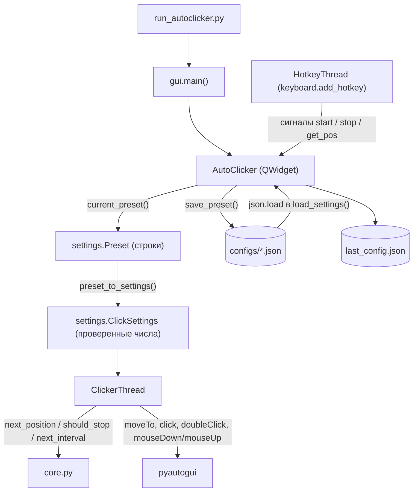

# Auto Clicker Pro — документация

Настольная программа на Python и PyQt6, которая нажимает кнопку мыши через
`pyautogui` с заданным интервалом, в текущей точке курсора или в заданных
координатах, со случайным разбросом интервала и позиции. Запуск, остановка и
захват координат доступны из окна и глобальными клавишами F6/F7/F8 через
библиотеку `keyboard`. Настройки сохраняются в JSON-пресеты (`README.md`,
`src/autoclicker/gui.py`). Интерфейс на русском языке; по словам автора,
«люди, которые пользуются этой программой, читают по-русски»
(`docs/decisions.md`, раздел «Point 12»). Кто именно эти пользователи, в
репозитории не сказано.

Спецификация требований, восстановленная по коду: [`SPEC.md`](../SPEC.md).

## 1. Состояние

| Что | Состояние | Источник |
| --- | --- | --- |
| Документируемый коммит | `a7140ba`, 2026-09-06, merge PR #23 | `git log -1` |
| Последний коммит собственного кода (`src/`, `run_autoclicker.py`, `configs/`, доменные тесты, `benchmarks/`) | `40b4b0c`, 2026-09-06 | `git log -1 -- src run_autoclicker.py configs ...` |
| Версия | `1.1.0`; аннотированный тег `v1.1.0` указывает на `a7140ba` | `pyproject.toml:7`, `src/autoclicker/__init__.py:3`, `git for-each-ref refs/tags` |
| История | 18 коммитов, первый — `3a7e02a` «v1.0.0» (2025-09-06: весь код в одном файле `autoclicker.py` на 526 строк, плюс два пресета в `configs/` и `.gitignore`) | `git log` |
| Тесты | 56: 21 в `tests/test_core.py`, 14 в `tests/test_settings.py`, 21 в `tests/test_branch_policy.py` (последний проверяет скрипт инструментария, а не программу); 7 бенчмарков | `pytest --collect-only -q`, `benchmarks/test_performance.py` |
| CI | GitHub Actions: `ci.yml`, `release.yml`, `branch-policy.yml`, `contribution-policy.yml`; Dependabot | `.github/` |
| Покрытие | `gui.py` исключён из замера покрытия; окно Qt не проверяется ни одним тестом | `pyproject.toml:121` |

Явно незаконченное или сломанное в `a7140ba`:

- **Запуск кликов не работает.** `ClickerThread.__init__` требует два
  аргумента, `settings` и `cursor` (`src/autoclicker/gui.py:66`), а
  `start_clicking` передаёт один (`src/autoclicker/gui.py:394`). Подробности в
  разделе 8, пункт 1.
- `estimate_run` и `format_duration` (`src/autoclicker/core.py:78-112`)
  реализованы и покрыты тестами, но из окна не вызываются.
- Обработчик `mousePressEvent` для захвата координат кликом
  (`src/autoclicker/gui.py:368-379`) недостижим: флаг `is_getting_position`
  нигде не становится `True`.

## 2. Состав

| Путь | Назначение |
| --- | --- |
| `run_autoclicker.py` | Точка входа: добавляет `src/` в `sys.path` и вызывает `autoclicker.gui.main()` |
| `src/autoclicker/core.py` | Чистые функции: интервал до следующего клика, точка клика, условие остановки, оценка длительности, форматирование длительности |
| `src/autoclicker/settings.py` | Перечисления кнопок и типов клика, таблицы русских подписей, валидируемый `ClickSettings`, формат файла `Preset`, чтение и запись пресета |
| `src/autoclicker/gui.py` | Окно `AutoClicker` (PyQt6), поток горячих клавиш `HotkeyThread`, поток кликов `ClickerThread`, `main()` |
| `src/autoclicker/__init__.py` | `__version__ = "1.1.0"` |
| `configs/Dota2Pudge.json` | Пресет из репозитория; его читают тест и скрипт скриншотов |
| `tests/test_core.py`, `tests/test_settings.py` | Тесты ядра и настроек, без экрана |
| `benchmarks/test_performance.py` | Бенчмарки функций, вызываемых на каждом клике |
| `docs/architecture.md`, `docs/decisions.md`, `docs/quality-iso25010.md` | Архитектура, сознательные отступления от стандарта, оценка ISO/IEC 25010 |
| `docs/screenshots/*.png` | Скриншоты окна для `README.md`, генерируются скриптом |
| `scripts/capture_usage_screenshots.py` | Снимает окно программы в `docs/screenshots/` |
| `scripts/build_release_artifact.py` | Собирает `autoclicker.exe` через PyInstaller и zip с контрольными суммами |

Файлы, которые программа создаёт при работе: каталог `configs/` и
`last_config.json` в текущем рабочем каталоге (`src/autoclicker/gui.py:176-177`);
`last_config.json` исключён из git (`.gitignore`).

## 3. Архитектура

Два слоя: `core.py` и `settings.py` не импортируют Qt, `pyautogui` и
`keyboard` (`src/autoclicker/core.py:14-17`, `src/autoclicker/settings.py:19-23`);
`gui.py` импортирует всё это и спрашивает у ядра, что делать на каждой
итерации (`docs/architecture.md`).



Поток данных при старте (`src/autoclicker/gui.py:381-397`, `76-109`):

1. Значения виджетов собираются в `Preset` — все поля строки, как в файле
   (`gui.py:399-416`).
2. `preset_to_settings` превращает их в `ClickSettings` или поднимает
   `SettingsError` с именем поля; окно показывает предупреждение «Ошибка ввода»
   (`gui.py:418-430`, `settings.py:198-249`).
3. `ClickerThread` в цикле берёт точку из `next_position`, двигает мышь, если
   задана фиксированная позиция или смещение, выполняет клик выбранного типа,
   увеличивает счётчик, проверяет `should_stop` и спит `next_interval` секунд.
4. Счётчик уходит в окно сигналом `update_counter`; по окончании сигнал
   `finished` вызывает `stop_clicking`.

Внешние зависимости — только локальные: мышь через `pyautogui`, глобальный
перехват клавиатуры через `keyboard`, окно через PyQt6. Сетевых обращений в
коде нет.

## 4. Сборка и запуск

Требования (`pyproject.toml`):

- Python `>=3.10` (`pyproject.toml:10`); CI гоняет тесты на 3.10 и 3.12, Ubuntu и
  Windows (`.github/workflows/ci.yml`).
- `PyQt6>=6.6`, `pyautogui>=0.9.54`, `keyboard>=0.13.5` (`pyproject.toml:19`).
  Версии рантайм-зависимостей нигде не зафиксированы: `requirements-dev.lock`
  их намеренно не содержит (комментарий в его заголовке).

Установка и запуск:

```bash
python scripts/install_dependencies.py        # pip install -e . — рантайм-зависимости
python scripts/install_dependencies.py --dev  # плюс pytest, ruff, mypy, radon, pre-commit
python run_autoclicker.py                     # открыть окно
```

Источники: `scripts/install_dependencies.py:3-5,100-101`, `run_autoclicker.py:3`,
`README.md` (раздел «Как использовать»). `README.md` предлагает вместо этого
создать `requirements.txt` вручную со строками `PyQt6`, `pyautogui`,
`keyboard`; такого файла в репозитории нет.

Сборка исполняемого файла для Windows:

```bash
pip install -e ".[release]"                               # pyinstaller>=6.0
python scripts/build_release_artifact.py --version v1.1.0
```

Результат в `release/`: `autoclicker.exe` (PyInstaller `--onefile --windowed`),
`autoclicker-<версия>-<os>-<arch>.zip` с `README.md`, `LICENSE`, `CHANGELOG.md`,
и `.sha256` к каждому файлу (`scripts/build_release_artifact.py:1-10,60-90,101-110,138-141`).
Тег `v*.*.*` запускает ту же сборку в `release.yml`, только на `windows-latest`.

Скриншоты для `README.md`:

```bash
python scripts/capture_usage_screenshots.py              # настоящее окно
python scripts/capture_usage_screenshots.py --offscreen  # без окна; текст выходит квадратиками
```

Скрипт подменяет `keyboard` и `pyautogui` заглушками до импорта окна
(`scripts/capture_usage_screenshots.py:42-66`).

## 5. Настройка

Переменных окружения программа не читает (поиск `os.environ`/`getenv` по
`src/` и `run_autoclicker.py` пуст). `sys.argv` целиком передаётся в
`QApplication` (`gui.py:540`); собственных флагов командной строки у программы
нет.

Файлы:

| Файл | Что хранит | Источник |
| --- | --- | --- |
| `configs/*.json` | Пресеты; список в окне строится из `configs/*.json` текущего рабочего каталога | `gui.py:176,447-455` |
| `last_config.json` | Обычный текст (не JSON): путь к последнему сохранённому или загруженному пресету | `gui.py:457-473` |

Поля пресета (все значения — строки, кроме флагов `*_enabled` и `hotkeys`):

| Поле | Значение | По умолчанию | Источник |
| --- | --- | --- | --- |
| `interval` | Интервал, целое число | `"100"` | `settings.py:118` |
| `interval_unit` | `"s"` — секунды; любое другое значение читается как миллисекунды | `"ms"` | `settings.py:119,206` |
| `click_count` | Число кликов, `0` — без ограничения | `"0"` | `settings.py:120`, `settings.py:110-111` |
| `mouse_button` | `"Левая"`, `"Правая"`, `"Средняя"` | `"Левая"` | `settings.py:42-46,121` |
| `click_type` | `"Один клик"`, `"Двойной клик"`, `"Перетаскивание"` | `"Один клик"` | `settings.py:48-52,122` |
| `drag_duration` | Удержание кнопки при перетаскивании, мс, целое | `"500"` | `settings.py:123,245` |
| `fixed_pos_enabled`, `coord_x`, `coord_y` | Кликать в точке X, Y (целые) | `false`, `""`, `""` | `settings.py:124-126,222-227` |
| `random_offset_enabled`, `random_offset_range` | Случайное смещение ± px по каждой оси | `false`, `"5"` | `settings.py:127-128` |
| `random_interval_enabled`, `random_interval_range` | Случайная добавка к интервалу ± мс | `false`, `"10"` | `settings.py:129-130` |
| `hotkeys` | `{"start", "stop", "get_pos"}` — строки для `keyboard.add_hotkey` | `F6`, `F7`, `F8` | `settings.py:57`, `gui.py:49-51,189` |

Горячие клавиши в окне показываются только для чтения (`gui.py:279,284,289`);
изменить их можно только полем `hotkeys` в файле пресета (`gui.py:523-528`).

## 6. Использование

Сценарии ниже описывают, что делает код. В коммите `a7140ba` шаг «Старт»
завершается ошибкой (раздел 8, пункт 1), так что запуск кликов на этой версии
не проверить.

1. **Клики в точке курсора.** Оставить значения по умолчанию (100 мс, `0` —
   без ограничения, левая кнопка, один клик), нажать «Старт» или F6, остановить
   «Стоп» или F7 (`gui.py:381-442`).
2. **Клики в заданной точке с разбросом.** Отметить «Фиксированное положение»,
   навести курсор на цель и нажать F8 — координаты попадут в поля X и Y
   (`gui.py:359-366`). Отметить «Случайное смещение (± px)» и «Случайный
   интервал (± ms)». Разброс интервала больше самого интервала отклоняется
   сообщением `random interval +/-N ms is wider than the interval ...`
   (`settings.py:101-107`).
3. **Конечная серия.** `Количество кликов: 5` — поток сам останавливается после
   пятого клика (`core.py:61-65`, `gui.py:103-105`).
4. **Пресеты.** «Сохранить настройки» открывает диалог в `configs/`; «Загрузить
   файл» — диалог выбора; выпадающий список «Доступные конфигурации» и кнопка
   «Загрузить» берут файл из `configs/`. Последний пресет загружается при
   следующем запуске (`gui.py:464-535`).
5. **Пресет вручную.** Формат — как в `configs/Dota2Pudge.json`: интервал
   `"50"` мс, фиксированная точка, смещение `"1"`, разброс `"25"` мс; кириллица
   там записана escape-последовательностями `Л...`.

## 7. Тестирование

```bash
pytest                                   # 56 тестов, pythonpath = src
pytest --cov                             # нужен pytest-cov; порог 85 % (pyproject.toml)
pytest benchmarks --benchmark-only       # нужен pytest-benchmark
python scripts/check_before_push.py      # то, что делает CI, локально
```

Источники: `pyproject.toml` (`[tool.pytest.ini_options]`, `[tool.coverage.*]`),
`README.md` (таблица «Качество»), `.github/workflows/ci.yml`.

Что покрыто: интервал и его разброс, детерминизм при одном seed, нижняя граница
1 мс, смещение позиции с фиксированной точкой и без, остановка, оценка
длительности, форматирование, чтение пресета из репозитория, круговая запись и
чтение, значения по умолчанию для старых пресетов, все правила валидации
(`tests/test_core.py`, `tests/test_settings.py`). Не покрыто: всё в `gui.py` —
окно, потоки, горячие клавиши, загрузка пресета из окна.

Тесты не требуют PyQt6, `pyautogui` и `keyboard`: пакет берётся из `src/` через
`pythonpath`, а `gui.py` они не импортируют (`pyproject.toml`, комментарий в
`[tool.pytest.ini_options]`).

## 8. Известные ограничения и проблемы

1. **«Старт» падает с `TypeError`.** `ClickerThread(settings)`
   (`gui.py:394`) против `def __init__(self, settings: ClickSettings, cursor)`
   (`gui.py:66`, без значения по умолчанию). Проверено статически разбором AST:
   определение требует `settings` и `cursor`, вызов передаёт один позиционный
   аргумент. По правилам Python такой вызов поднимает `TypeError`. Параметр
   `cursor` добавлен в `40b4b0c`, вызов остался от `v1.0.0`
   (`git blame`). Не проверено запуском (PyQt6 в этой среде не установлен), поэтому
   что происходит с процессом дальше, не наблюдалось; предположение — PyQt6
   по умолчанию завершает приложение при необработанном исключении в слоте. Тесты не импортируют
   `gui.py`, а скрипт скриншотов не нажимает «Старт», поэтому CI этого не видит.
   Тег `v1.1.0` указывает на тот же коммит, и опубликованный релиз `v1.1.0`
   собран из него (GitHub API, см. `SPEC.md`, открытый вопрос 6).
2. **Пресет, сохранённый программой, может не загрузиться обратно в окно.**
   `save_preset` пишет UTF-8 с `ensure_ascii=False` (`settings.py:184-188`), а
   `load_settings` в окне открывает файл без указания кодировки
   (`gui.py:504`). Проверено декодированием: UTF-8-байты подписей `Левая`,
   `Правая`, `Средняя`, `Перетаскивание` в cp1252 дают `UnicodeDecodeError`, в
   cp1251 — другие строки. Вывод, не проверенный запуском окна: в Windows без
   UTF-8 режима Python такой пресет либо не загрузится («Не удалось загрузить
   файл»), либо подписи кнопки и типа клика не применятся. На машине, где
   писался этот документ, включён UTF-8 режим (`sys.flags.utf8_mode == 1`), и
   проблема там не воспроизвелась бы. `configs/Dota2Pudge.json` записан
   escape-последовательностями и под это не попадает.
3. **Два разных чтения одного формата.** Окно читает пресет сырым `json.load`
   и `dict.get` с собственными умолчаниями (`gui.py:503-521`), а не через
   `load_preset`/`Preset.from_mapping` (`settings.py:133-156,177-181`), которые
   покрыты тестами.
4. **Горячие клавиши регистрируются повторно.** Каждая загрузка пресета с полем
   `hotkeys` создаёт новый `HotkeyThread` (`gui.py:523-528`, `192-197`), а
   прежние обработчики снимаются только при закрытии окна
   (`keyboard.unhook_all()`, `gui.py:185`). Вывод: обработчики копятся; лишние
   «Старт» гасит проверка `if self.clicking: return` (`gui.py:382`).
5. **Счётчик считает попытки.** Исключение `pyautogui` внутри клика
   печатается в stdout, после чего `clicks_done` всё равно увеличивается
   (`gui.py:97-101`). Сборка для релиза идёт с `--windowed`
   (`scripts/build_release_artifact.py:67`); вывод, не проверенный запуском:
   в `.exe` это сообщение не видно. `pyautogui.moveTo` вызывается вне `try`
   (`gui.py:84-85`).
6. **Пути относительно рабочего каталога.** `configs/` и `last_config.json`
   ищутся в текущем каталоге процесса (`gui.py:176-177`). Каталог `configs/`
   создаётся при каждом запуске (`populate_config_list`, `gui.py:448`,
   вызывается в `gui.py:182`), а не «при первом сохранении», как пишет
   `README.md`.
7. **`README.md` расходится с кодом.** «Случайное смещение … работает только при
   включённом фиксированном положении» — ядро применяет смещение и к точке
   курсора (`core.py:51-57`, тест
   `test_the_offset_applies_with_or_without_a_fixed_position`); окно лишь
   выключает чекбокс без фиксированной позиции, но не снимает отметку
   (`gui.py:350`), а `current_preset` читает `isChecked()` (`gui.py:411`).
   `README.md` требует «Python 3.x», `pyproject.toml` — `>=3.10`.
   `CHANGELOG.md` (1.1.0) пишет, что неверная настройка отклоняется «when it is
   entered»; в коде проверка выполняется только при старте
   (`get_current_settings` вызывается из одного места, `gui.py:385`).
8. **Только целые числа.** Интервал, длительность перетаскивания, координаты и
   диапазоны проходят через `_whole_number` (`settings.py:191-195`): `"1.5"`
   секунды отклоняются. Минимальный интервал — 1 мс.
9. **Платформа.** Релиз собирается только для Windows; в комментариях
   `release.yml` и `pyproject.toml` сказано, что `keyboard` требует root на
   Linux, а `pyautogui` — дисплей. `README.md` описывает установку на macOS и
   Linux, но сборки и проверки окна для них нет.
10. **Неиспользуемый код в `gui.py`:** `hotkeys_to_string` (`gui.py:339`),
    `self.key_inputs` (`gui.py:190`), ветка `mousePressEvent`
    (`gui.py:368-379`).
11. **Фактический ритм не измерен.** Код не задаёт `pyautogui.PAUSE` и
    `pyautogui.FAILSAFE` (поиск по `src/` пуст). Если у `pyautogui` по умолчанию
    есть пауза после каждого вызова (в этой среде библиотека не установлена, не
    проверено), реальный интервал больше настроенного. Вопрос вынесен в
    [`SPEC.md`, раздел 9](../SPEC.md#9-открытые-вопросы).

## 9. Инструментарий репозитория

Проект следует стандарту
[repo-quality-template](https://github.com/IGORSVOLOHOVS/repo-quality-template),
ревизия 2 (`README.md`, раздел «Качество»; `docs/decisions.md`). Это вариант
стандарта для GitHub: `.github/workflows/*`, без `recipe.ps1`, `.claude/` и
`.gitea/`, поэтому переменных `$App`/`$Provides` и глаголов `recipe.ps1` здесь
нет. Сделано под этот проект:

- `pyproject.toml`, `[tool.repo-quality]`: код веток `acl`, долгоживущие ветки
  `release`, `dev`, `test`, префиксы ботов `dependabot/`, `renovate/`, области
  коммитов `core`, `settings`, `gui`, `ci`, `docs`, `scripts`, `benchmarks`,
  `release`.
- `mypy --strict` только по `core.py` и `settings.py`; покрытие без `gui.py`;
  для `gui.py` отключены правила ruff `C90`, `S`, `E501`, `RUF001-003`, для
  `settings.py` — `RUF001-003` (`pyproject.toml`, обоснование в
  `docs/decisions.md`).
- `release.yml` и `scripts/build_release_artifact.py`: только Windows,
  PyInstaller из `run_autoclicker.py`, `--windowed`, исключены `PyQt5`,
  `PySide2`, `PySide6`.
- `scripts/capture_usage_screenshots.py` снимает именно это окно и пресет
  `configs/Dota2Pudge.json`.
- `requirements-dev.lock` не содержит PyQt6, `pyautogui`, `keyboard`.

Остатки шаблона, не адаптированные под проект:

- `scripts/profile_application.py` импортирует `quality_template.core`
  (строка 22), которого здесь нет; запуск
  `python scripts/profile_application.py --help` завершается
  `ModuleNotFoundError: No module named 'quality_template'`.
- `.github/ISSUE_TEMPLATE/bug_report.yml:37` предлагает
  `python -m quality_template.cli ...`.
- `CHANGELOG.md` содержит записи самого шаблона: второй блок `### Added` под
  1.1.0 (упоминает `docs/standards-comparison.md` и
  `scripts/apply_template_to_repo.py`, которых в репозитории нет) и раздел
  `[1.0.0] - 2026-08-01` про анализ текста и tkinter со ссылками на
  `repo-quality-template`.
- `CONTRIBUTING.md` совпадает с шаблоном побайтно: клонирует
  `repo-quality-template` и приводит ветку `rqt-12/...`.

## 10. Связанные документы

- [`../README.md`](../README.md) — описание для пользователя, установка, горячие клавиши
- [`../SPEC.md`](../SPEC.md) — спецификация требований
- [`architecture.md`](architecture.md) — два слоя и что сознательно не сделано
- [`decisions.md`](decisions.md) — отступления от стандарта и их причины
- [`quality-iso25010.md`](quality-iso25010.md) — оценка ISO/IEC 25010 и замеры бенчмарков
- [`workflow.md`](workflow.md), [`branching.md`](branching.md) — путь изменения и ветки
- [`../CHANGELOG.md`](../CHANGELOG.md), [`../CONTRIBUTING.md`](../CONTRIBUTING.md), [`../SECURITY.md`](../SECURITY.md), [`../LICENSE`](../LICENSE)

## 11. Об этом документе

Написан 2026-11-18 по коммиту `a7140ba` (ветка `docs/spec-and-docs` от
`origin/dev`). Каждое утверждение взято из открытого файла или из вывода
команды; выводы помечены как выводы.

Запускалось (Python 3.13.3, Windows):

- `git ls-files`, `git log`, `git blame -L 66,75` и `-L 385,397` по `gui.py`,
  `git for-each-ref refs/tags`, `git show 3a7e02a:autoclicker.py`;
- `python -m pytest -p no:cacheprovider -o addopts= -q` — `56 passed in 0.49s`;
  `--collect-only -q` — 21/21/14 по файлам;
- разбор `gui.py` через `ast`: сигнатура `ClickerThread.__init__` и вызов в
  строке 394;
- декодирование UTF-8-байтов шести русских подписей в cp1252 и cp1251;
- `python scripts/profile_application.py --help` — `ModuleNotFoundError`;
- поиск `os.environ`, `getenv`, `PAUSE`, `FAILSAFE` по `src/`.

Не запускалось: окно программы и клики (PyQt6, `pyautogui`, `keyboard` не
установлены, запуск служб запрещён условиями работы); `pytest --cov` и
бенчмарки (нет `pytest-cov`, `pytest-benchmark`); `ruff`, `mypy`,
`scripts/collect_quality_metrics.py`, `scripts/check_before_push.py`; сборка
PyInstaller; результаты CI на GitHub (сетевые запросы не делались). Цифры
`README.md` и `docs/quality-iso25010.md` (оценка 91.0, 1.1 мкс на клик,
сложность 2.32) здесь не перепроверялись.
